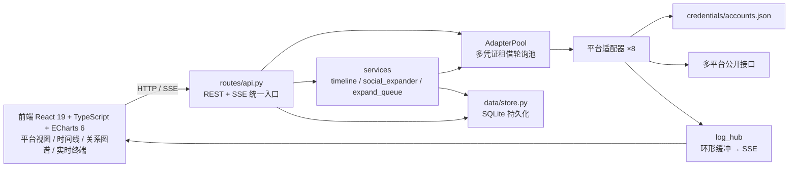
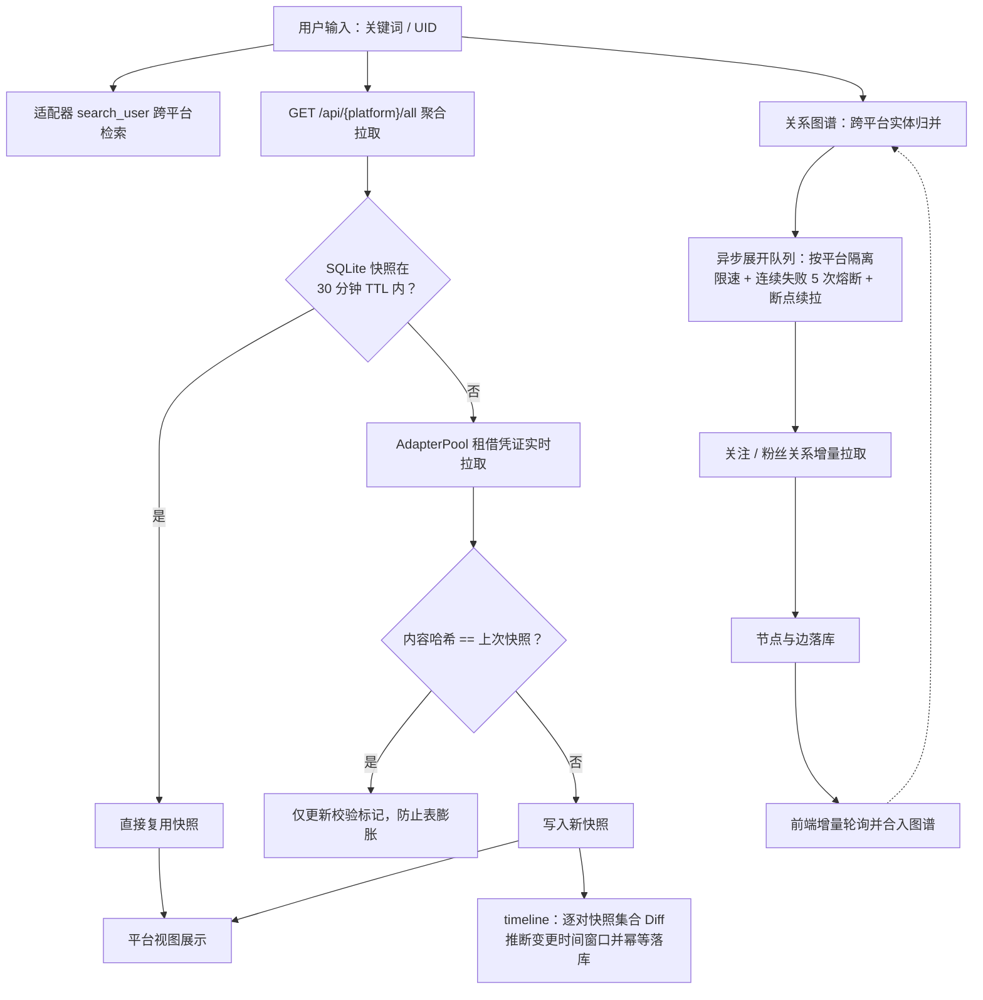

<div align="center">

# Sight

**多源公开实体画像与社交关系图谱分析平台**

*Multi-Platform Public Entity Profiling, Timeline Diffing & Social Graph Analytics Platform*

[](https://github.com/element-17/Sight/actions/workflows/ci.yml)
[](https://github.com/element-17/Sight/releases)
[](https://github.com/element-17/Sight/actions/workflows/release.yml)


</div>

---

## 项目简介

**Sight** 是一个面向多平台公开数据的**实体信息聚合、行为时序演化分析与社交关系图谱可视化平台**。通过统一的平台适配器架构，将分散在各公开社区与内容平台中的碎片化公开信息整合为可追溯、可对比、可交互的结构化视图，适用于开源开发者调研、创作者公开档案分析与跨平台关系网络研究。

### 核心能力

- **多源公开数据聚合**：抽象统一 `Adapter` 契约与 `AdapterPool` 多凭证租借轮询池，支持 8 个公开平台的实体检索与聚合查询，配合 30 分钟快照 TTL 与内容哈希去重机制降低重复请求与表膨胀。
- **时序快照 Diff 与行为演化时间线**：持久化各时间节点的公开状态快照，通过逐对集合 Diff 自动推断跨时段变更窗口，并以 `dedup_key` 幂等落库，支持统一时间线检索与导出。
- **交互式社交关系图谱**：后端按平台隔离异步展开队列（内置速率限制、连续失败 5 次自动熔断与 `skip` 断点续拉），前端基于 **ECharts 6** 增量轮询并动态渲染实体关联网络。
- **实时运行终端（SSE）**：通过 `log_hub` 环形缓冲实时镜像后端任务与适配器运行状态，借助 Server-Sent Events 推送至前端可视化终端。
- **AI Agent 智能实体侧写（Roadmap）**：规划将平台检索、时序对比与图谱扩展封装为标准 Agent Tools，结合证据溯源自动生成一站式结构化实体画像报告。

---

## 支持平台

| 类别 | 已集成公开平台 |
| :--- | :--- |
| 开源与技术社区 | GitHub |
| 影音与内容社区 | 哔哩哔哩、抖音、小红书、微博 |
| 音乐与兴趣社区 | 网易云音乐、QQ 音乐、原神 |

---

## 架构与数据流



### 核心查询与图谱展开流程



---

## 快速开始

### 方式一：直接下载预打包独立可执行版（推荐，免装 Python）

前往 [GitHub Releases](https://github.com/element-17/Sight/releases/latest) 下载对应系统压缩包，解压后直接运行即可（默认自动打开浏览器并监听 `http://127.0.0.1:5001`）：

- **Windows (x64)**：`Sight-v*-windows-x64.zip` → 双击 `Sight.exe`（或 `start.bat`）
- **macOS (Apple Silicon)**：`Sight-v*-macos-arm64.tar.gz` → 运行 `./Sight` 或双击 `start.command`
- **Linux (x64)**：`Sight-v*-linux-x64.tar.gz` → 运行 `./Sight` 或 `./start.sh`

> 凭证 (`credentials/`)、SQLite 数据库 (`data/`) 与日志 (`logs/`) 默认保存在可执行文件同级目录，也可通过 `SIGHT_DATA_DIR` 环境变量自定义；支持 `--port` / `--host` / `--no-browser` 参数。小红书与抖音部分 JS 签名接口需本机安装 Node.js 22+，其余平台零外部依赖。

### 方式二：源码运行

#### 环境要求

- **Python** `3.10+`
- **Node.js** `22.12+`（前端构建与运行时依赖）

#### 启动后端与托管界面

```bash
python -m venv .venv
.venv\Scripts\activate          # Windows；macOS/Linux 使用 source .venv/bin/activate
pip install -r requirements.txt
python run.py                   # 默认监听 http://127.0.0.1:5001
```

### 前端开发与测试

```bash
cd frontend
npm install
npm run dev                     # Vite 开发服务器（默认 5173）
npm run typecheck               # TypeScript 类型检查
npm test                        # Vitest 单元测试
npm run test:e2e                # Playwright 端到端测试
npm run build                   # 构建生产产物至 app/web/
```

### 自动打包与发版（CI/CD）

本项目通过 [`.github/workflows/release.yml`](.github/workflows/release.yml) 实现自动测试、跨平台打包与 Release 发布：

- **自动发版**：每次推送到 `master` 分支时，CI 自动运行后端单测、前端类型检查/单元测试/构建与 Playwright E2E 测试，随后在 Windows、macOS、Linux 三端使用 PyInstaller 打包独立可执行程序并执行真实启动冒烟测试，全部通过后自动创建版本标签、生成分组 Changelog 与 `SHA256SUMS.txt` 并发布 GitHub Release。
- **语义化版本规则**：基于 Conventional Commits 自动递增——含 `BREAKING CHANGE:` / `!:` 升主版本，含 `feat:` 升次版本，其余提交升修订号（如 `v0.1.0 → v0.2.0 / v0.2.1`）。
- **按需控制**：在提交信息中加入 `[skip release]` 可跳过本次发版；也可推送 `v*.*.*` 标签或直接在 GitHub Actions 页面手动触发（支持自定义版本号、预发布标记与 `dry_run` 演练模式）。

---

## 凭证配置

可选凭证统一保存在本地 `credentials/accounts.json`（已被 `.gitignore` 忽略），推荐直接在界面「图谱页状态条 → 配置凭证」弹窗中管理，也可按如下格式手动配置多凭证轮询池：

```json
{
  "netease": [
    { "id": "primary", "name": "主账号", "cookie": "k=v; k2=v2", "enabled": true },
    { "id": "acc_xxx", "name": "附加账号", "cookie": "k=v", "enabled": true }
  ]
}
```

- `id` 为 `primary` 的条目作为默认主凭证，其余启用的条目自动参与 `AdapterPool` 轮询并发。
- 未配置凭证也可正常启动服务，仅对应需鉴权的公开平台接口受限。

---

## 项目结构

```text
Sight/
├── app/
│   ├── routes/                  # 模块化 REST / SSE Blueprint 路由（统一异常转 JSON 边界）
│   ├── platforms/               # 适配器抽象基类、AdapterPool 池化管理与 8 平台实现
│   ├── services/                # timeline 时序 Diff、social_expander、异步展开队列、log_hub
│   ├── data/store.py            # SQLite 快照 / 时间线 / 图谱 / 任务状态存储
│   ├── credentials/             # 本地凭证管理
│   └── web/                     # 前端生产构建静态产物
├── frontend/src/                # React 19 + TS + Zustand + ECharts 6 前端源码
├── tests/                       # 后端契约与单元测试（GitHub Actions CI 自动执行）
├── docs/                        # API 契约、架构开发手册与调研文档
└── run.py                       # 应用入口
```

---

## 工程文档

- [`docs/API.md`](docs/API.md)：REST / SSE 接口契约总览
- [`docs/MANUAL.md`](docs/MANUAL.md)：平台适配器规范、错误边界约定与新平台接入指南
- [`docs/BILIBILI_ARCHIVES.md`](docs/BILIBILI_ARCHIVES.md)：公开存档数据源调研与接入说明

---

## 开源致谢

本项目在部分平台接口研究与适配过程中参考了以下开源项目，特此致谢：

| 上游项目 | 许可 | 说明 |
| :--- | :--- | :--- |
| [cv-cat/DouYin_Spider](https://github.com/cv-cat/DouYin_Spider) | — | 抖音公开接口适配参考与问题修复 |
| [cv-cat/Spider_XHS](https://github.com/cv-cat/Spider_XHS) | — | 小红书公开接口适配参考 |
| [nghuyong/WeiboSpider](https://github.com/nghuyong/WeiboSpider) | MIT | 微博关注/粉丝列表请求构造参考 |

---

## 免责声明

本项目仅用于**全栈工程架构、多源数据聚合、图谱可视化与智能体分析技术的学习与研究**。使用本项目时请仅访问合法公开信息，严格遵守各平台服务条款、访问频率限制及相关隐私保护法律法规，严禁用于任何侵犯他人隐私或违反平台规则的用途。
